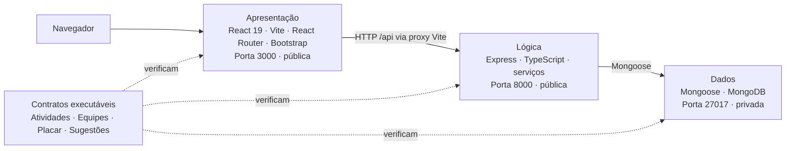

# Arquitetura do OctoFit Tracker

O OctoFit Tracker é uma aplicação de três camadas para um programa de atividades físicas escolar. O código inicial inclui contratos de API e pontos de implementação intencionalmente incompletos para que você use o modo agent do GitHub Copilot em um ciclo guiado por testes.

## Limites entre as camadas

- **Camada de apresentação**: React 19, Vite, React Router, Bootstrap e um cliente compartilhado da API em `octofit-tracker/frontend/src`.
- **Camada de lógica**: rotas e serviços Express com TypeScript em `octofit-tracker/backend/src` expõem o comportamento `/api/*` na porta `8000`.
- **Camada de dados**: modelos Mongoose e dados de demonstração em `octofit-tracker/backend/src/models` e `src/scripts/seed.ts` são persistidos no MongoDB na porta `27017`.

## Portas e regras de ambiente

- MongoDB: `27017` (privada)
- API Express: `8000` (pública)
- Interface Vite: `3000` (pública)
- O navegador acessa caminhos relativos `/api`. O Vite os encaminha para `http://localhost:8000`; `VITE_API_BASE_URL` pode substituir a URL-base.
- Não encaminhe nem torne públicas outras portas.

## Contrato da API

| Capacidade | Método e caminho | Comportamento esperado |
| --- | --- | --- |
| Registro de atividades | `GET /api/activities`, `POST /api/activities` | Lista e cria atividades válidas. POST recebe `userId`, `teamId`, `type` e `minutes`; `userId` e `teamId` devem ser IDs bem-formados de uma pessoa e uma equipe existentes, caso contrário a API retorna um 4xx intencional (nunca um 500 causado por erro de conversão). Uma atividade criada armazena `user`, `team`, `type` e `minutes` enviados, além de `points` e `occurredAt` calculados. |
| Equipes | `GET /api/teams`, `POST /api/teams` | Lista e cria equipes com integrantes. As equipes criadas e listadas mantêm os valores enviados em `name` e `mascot`. Rejeita uma equipe sem nome com `400`. |
| Placar | `GET /api/leaderboard` | Retorna as equipes ordenadas pela soma dos pontos de suas atividades, da maior para a menor. Cada item contém `teamName`, `totalPoints` e uma `rank` iniciada em 1. |
| Sugestões de treino | `GET /api/workouts/suggestions/:userEmail` | Recomenda treinos com base nos padrões de atividade recentes da pessoa correspondente ao e-mail seed. O foco da primeira sugestão (`focus`) corresponde à meta ou à atividade recente dessa pessoa, e o campo `reason` explica o motivo. Um e-mail sem pessoa correspondente retorna um 4xx intencional (por exemplo, `404`). |

## Decisões de implementação

- Decisão da camada de apresentação: consumir a API pelo cliente compartilhado em `/api`, com telas para as quatro capacidades e estados acessíveis de carregamento, vazio e erro.
- Decisão da camada de lógica: manter rotas Express enxutas, delegar regras aos serviços e converter entradas inválidas ou referências inexistentes em respostas 4xx, nunca em erros de conversão 500.
- Decisão da camada de dados: definir schemas Mongoose com campos obrigatórios, referências e validações coerentes com os contratos; popular dados demonstrativos por upsert idempotente sem apagar registros existentes.
- Abordagem para registro de atividades: validar formato e existência de `userId` e `teamId`, persistir as referências e os valores enviados, e calcular `points` e `occurredAt` no serviço.
- Abordagem para gerenciamento de equipes: rejeitar `name` ausente com 400, preservar `name` e `mascot` e resolver os integrantes enviados para referências de pessoas existentes.
- Abordagem para o placar: somar os pontos das atividades por equipe, ordenar do maior total para o menor e numerar `rank` a partir de 1.
- Abordagem para sugestões de treino: localizar a pessoa pelo e-mail, usar meta e atividade recente para definir o foco da primeira sugestão e explicar a recomendação em `reason`; retornar 4xx quando não houver pessoa correspondente.

## Plano de testes

Executar em ordem: dados, API, interface e compilações. Resultado observado no estado inicial:

- Testes da camada de dados: `npm run test:data --prefix octofit-tracker/backend` — na execução conjunta de `npm test --prefix octofit-tracker/backend`, 4 testes falharam porque os schemas não exigem os campos contratuais de `User`, `Team`, `Activity` e `Workout`; o teste de seed idempotente passou.
- Testes da API: `npm run test:api --prefix octofit-tracker/backend` — na mesma execução conjunta, 4 testes falharam: validação de atividades e equipes respondeu 501 em vez de 400, placar retornou lista vazia e a sugestão não explicou o motivo. Implementar dados primeiro reduz falhas causadas por dependências ausentes.
- Testes do frontend: `npm test --prefix octofit-tracker/frontend` — 15 testes falharam; as telas ainda exibem implementação pendente e não atendem aos contratos de conteúdo, carregamento, estado vazio e erro acessível.
- Compilação do backend: `npm run build --prefix octofit-tracker/backend` — passou; a falha funcional não é um erro de TypeScript.
- Compilação do frontend: `npm run build --prefix octofit-tracker/frontend` — passou; a falha dos testes é de comportamento/renderização, não de compilação.
